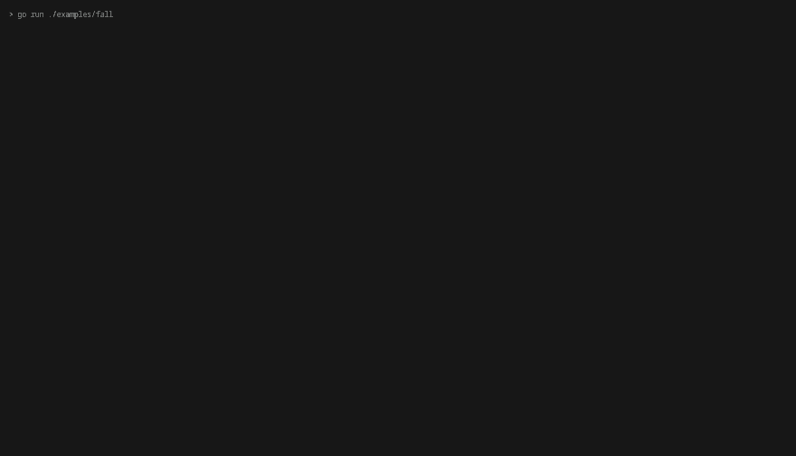
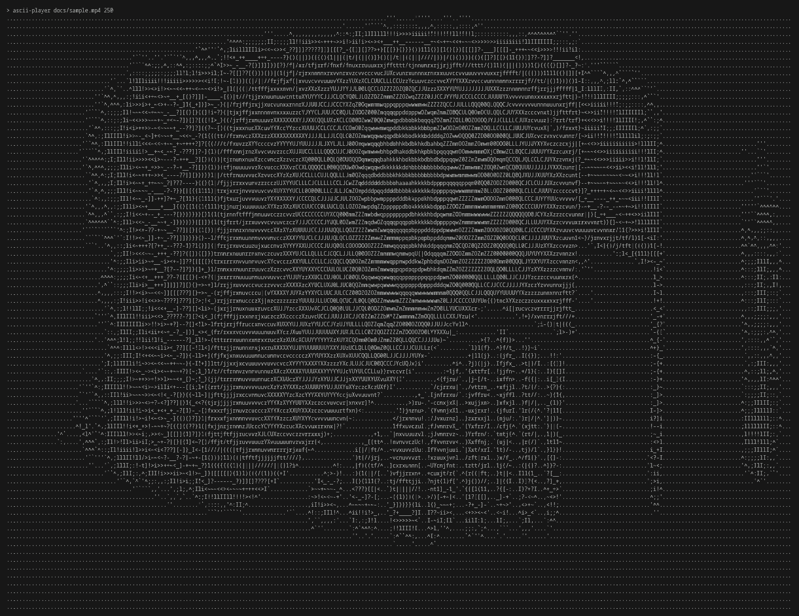

# ascii_render

[](https://pkg.go.dev/github.com/benjaestupinan/ascii_render)
[](LICENSE)

A Go library for rendering scenes and games as ASCII art in the terminal.

`ascii_render` gives you a grid of light values, one per terminal character,
and a game loop that draws it on screen. You write the scene; the library
takes care of turning it into text, timing the frames, and restoring the
terminal when you're done. It also ships with a player that shows images and
videos as ASCII art.

> [!WARNING]
> This project is in early development. The API may change between versions.

## Preview

A ball bouncing with gravity, drawn with the engine (`examples/fall`):



This spooky GIF shows how the player looks (`cmd/ascii-player`):



<sub>*Nosferatu* (F. W. Murnau, 1922), public domain, at 250 columns.</sub>

## Features

- **Monochrome frame buffer**: every cell holds a light value between 0 and 1,
  drawn with a 70-character brightness ramp.
- **Game loop**: implement `Update` and `Draw`, and `engine.Run` animates your
  scene at 30 fps with a measured delta time.
- **Keyboard input**: map key names to actions, and the engine runs them
  before each `Update`, in the same goroutine as your scene.
- **Clean terminal handling**: runs in the alternate screen with a hidden
  cursor, and leaves the terminal exactly as it was on exit.
- **Images and video**: convert any `image.Image` to a frame, and play `.mp4`
  files at their original frame rate.
- **Correct proportions**: accounts for terminal characters being about 2.4
  times taller than they are wide, so circles look round.

## Installation

Requires Go 1.27 or later.

To use the library in your project:

```sh
go get github.com/benjaestupinan/ascii_render
```

To install the image and video player:

```sh
go install github.com/benjaestupinan/ascii_render/cmd/ascii-player@latest
```

Playing videos also requires [FFmpeg](https://ffmpeg.org/download.html)
(`ffmpeg` and `ffprobe`) to be installed and in your `PATH`. Images don't need it.

## Usage

### Writing a scene

A scene is any type with an `Update` and a `Draw` method. This one draws a
comet that crosses the screen and then exits:

```go
package main

import (
	"fmt"

	"github.com/benjaestupinan/ascii_render/engine"
	"github.com/benjaestupinan/ascii_render/render"
)

type comet struct {
	x float32 // 0 is the left edge, 1 the right one
}

// Update advances the scene dt seconds.
func (c *comet) Update(dt float32) error {
	c.x += dt / 4 // cross the screen in 4 seconds
	if c.x > 1 {
		return engine.ErrQuit // finish normally
	}
	return nil
}

// Draw paints the current state into f, which arrives black.
func (c *comet) Draw(f *render.Frame) {
	col := int(c.x * float32(f.Width))
	for i := range 12 {
		f.Set(col-i, f.Height/2, 1-float32(i)/12)
	}
}

func main() {
	if err := engine.Run(&comet{}); err != nil {
		fmt.Println("error running the engine:", err)
	}
}
```

### Reading the keyboard

To use the keyboard, add a `KeyActions` method to your scene. `engine.Run`
calls it once at the start, and then runs the action of every key pressed
before the next `Update`. Adding this to the comet above restarts it with
space and quits with `q`:

```go
func (c *comet) KeyActions() engine.KeyActionMap {
	return engine.KeyActionMap{
		"space": func() error { c.x = 0; return nil },
		"q":     func() error { return engine.ErrQuit },
	}
}
```

Characters are named after themselves (`"a"`, `"1"`, `"?"`), and special keys
by lowercase names: `"up"`, `"down"`, `"left"`, `"right"`, `"space"`,
`"enter"`, `"esc"`, `"f1"` to `"f12"`, `"insert"`, `"delete"`, `"home"`,
`"end"`, `"pgup"` and `"pgdn"`. Keys without an action are ignored, and
Ctrl+C always quits.

### Running the examples

```sh
git clone https://github.com/benjaestupinan/ascii_render.git
cd ascii_render

go run ./examples/move   # a comet crossing the screen
go run ./examples/fall   # a ball bouncing with gravity
go run ./examples/keys   # a snake you steer with the arrow keys or WASD
```

### Playing images and videos

If you installed the player with `go install`:

```sh
ascii-player <image or video> <columns>
```

```sh
ascii-player photo.png 120
ascii-player video.mp4 200
```

`go install` puts the binary in `$(go env GOPATH)/bin` (usually `~/go/bin`),
so that directory has to be in your `PATH`.

From a clone of the repository, without installing it:

```sh
go run ./cmd/ascii-player photo.png 120
```

Supported formats are `.png`, `.jpeg` and `.mp4`. The number of columns sets
the width of the output; the height is computed to keep the proportions.

## How it works

**Light, not color.** A `Frame` stores one number per terminal character: its
light, from 0 (black) to 1 (white). When the frame is printed, each value picks
a character from a brightness ramp ordered from the emptiest to the densest:

```
.'`^,:;Il!i><~+_-?][}{1)(|/tfjrxnuvczXYUJCLQ0OZmwqpdbkhao*#MW&8%B@$
```

Dense characters like `@` cover more of their cell with ink, so they look
brighter on a dark terminal. Scenes never deal with characters: they only set
light values, and the frame takes care of the rest.

**Characters aren't square.** A terminal character is about 2.4 times taller
than it is wide. If one cell were used as one pixel, every image would come out
stretched vertically and circles would look like tall ellipses. To compensate:

- `FromImage` averages blocks of pixels that are 2.4 times taller than wide.
- Scenes can measure their world in their own units (the examples use meters)
  and use 2.4 times more columns than rows per unit when drawing.

**Drawing without flicker.** Clearing the screen before every frame makes it
blink. Instead, `engine.Run` moves the cursor back to the top-left corner
(`\033[H`) and writes the new frame over the previous one. It also runs in the
terminal's alternate screen, the same one editors like `vim` use, so your
scrollback history is untouched when the program exits.

**Video in parallel.** The player decodes video in a separate goroutine that
reads frames ahead into a small pool of reusable buffers, while the main
goroutine converts and prints them at the video's frame rate. Two channels pass
buffer indices back and forth, so no buffer is ever read and written at the
same time.

## Packages

| Package | Description |
| --- | --- |
| [`render`](render) | `Frame`, the grid of light values, and `FromImage` to build one from an image. |
| [`engine`](engine) | `Game`, the interface your scene implements, `Run`, the game loop, and `KeyHandler` for keyboard input. |
| [`cmd/ascii-player`](cmd/ascii-player) | Command-line image and video player. |
| [`examples`](examples) | Small scenes built with the library. |

## Development

```sh
go test ./...                  # run the tests
go test -bench=. ./render      # run the benchmarks
go vet ./...
```

## License

Distributed under the MIT License. See [`LICENSE`](LICENSE) for details.
